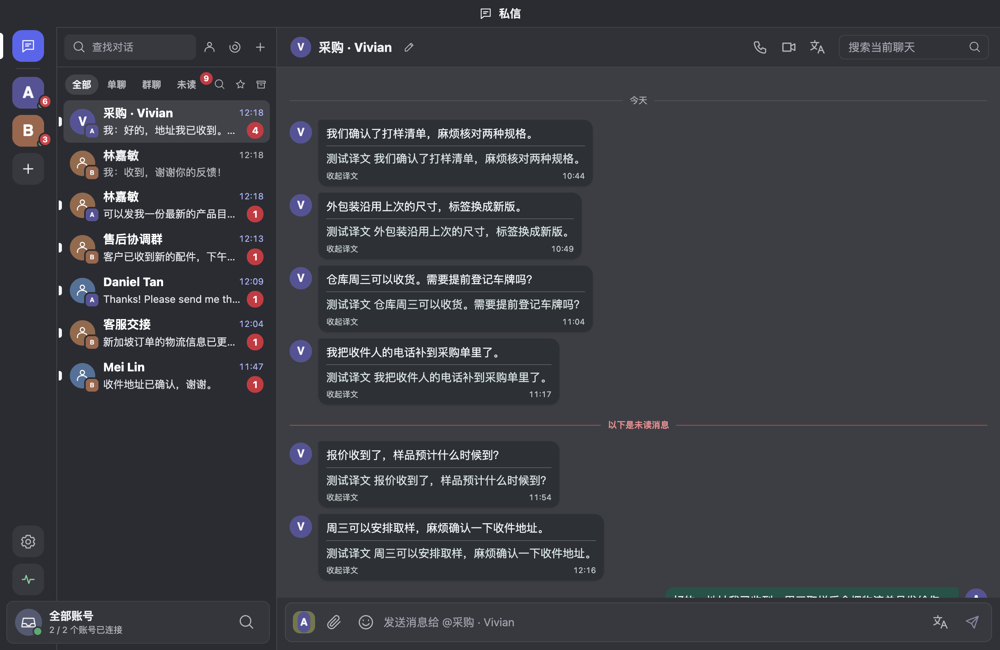
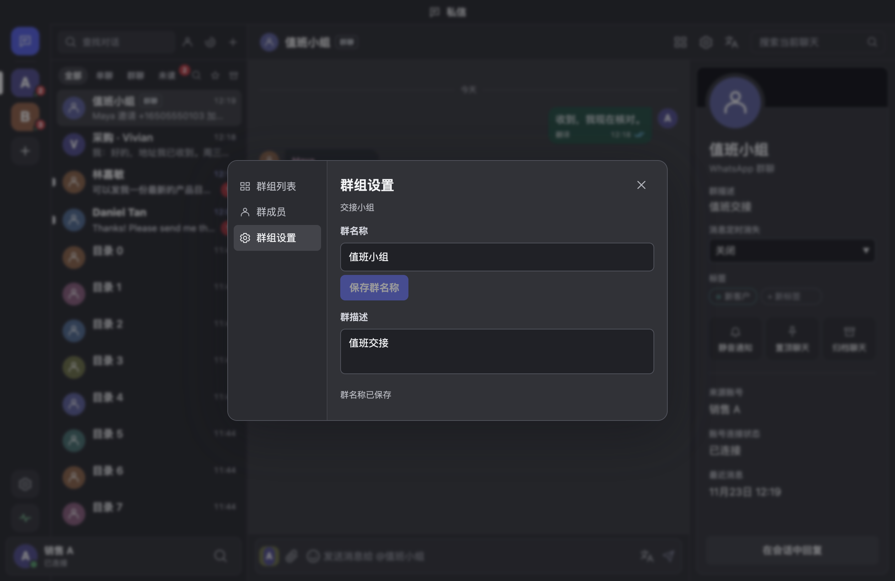
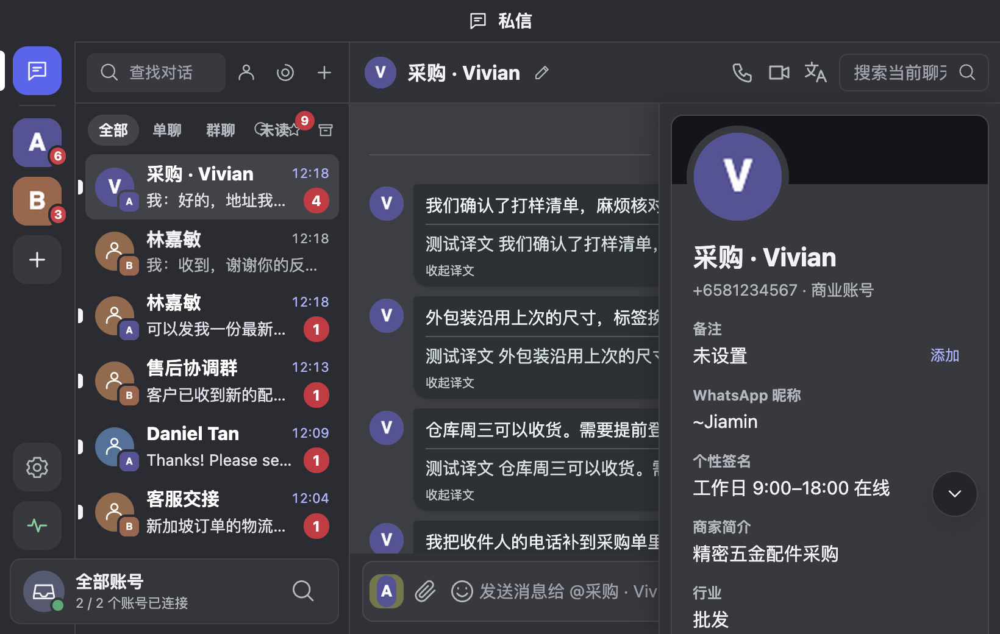
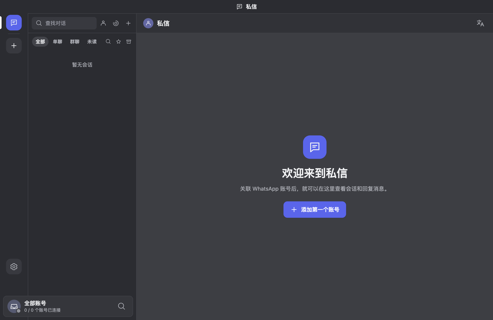

# HaiA 桌面 UI 规范

适用版本 0.9.3。使用者在一台电脑管理多个 WhatsApp 号码，在「全部账号」阅读跨账号消息，在具体对话中以来源号码回复。macOS 和 Windows 共用页面、交互和设计变量。

## 框架选型

第一版采用 Electron 45.4.1。独立持久化 Chromium 分区保存设备关联，后台 WA-JS 4.8.2 读取消息和会话事件。前台使用本地 HTML 和受限 IPC 自行渲染、接收通知和提交文本回复。统一消息列表通过「账号 UUID + 消息 ID」去重，同名联系人由来源账号与会话 ID 区分。

| 选择依据 | Electron | Tauri 2 |
| --- | --- | --- |
| 后台网页适配 | 随应用发布指定 Chromium，两个平台共享网页运行时版本 | Mac 使用系统 WKWebView，Windows 使用 WebView2，同一接口需要分端验证 |
| 多账号持久化 | 每个账号绑定一个 persist 分区，模拟账号已通过独立进程重启测试 | 可选独立数据存储，Mac 的有名 WKWebView 存储标识需要 macOS 14 及以上 |
| 安装与运行成本 | 安装包包含 Chromium，每个活跃账号运行后台页面 | 安装包通常更小。使用同样的后台网页架构时，账号仍会消耗 WebView 资源 |
| 后续复评条件 | 当前扫码个人号方案优先保障兼容性 | 改为服务器通过官方 Cloud API 接收 webhook，或有明确包体积要求时，按同等账号数复测 |

没有进行两个框架的同负载内存测试。WA-JS 属于非官方接口，网页版升级可能需要更新适配。程序退出后实时接收暂停。官方 Business Platform 属于另一种账号接入方式。

依据见 [Electron session](https://www.electronjs.org/docs/latest/api/session)、[Tauri WebView](https://v2.tauri.app/reference/webview-versions/)、[Tauri 平台配置](https://v2.tauri.app/reference/config/) 和 [WA-JS 文档](https://wppconnect.io/wa-js/)。

## Discord 私信布局

视觉基准为用户提供的 Discord 私信页截图。界面固定使用炭灰深色主题，采用 Discord 的账号图标栏、私信列表、消息时间线和联系人资料栏。系统窗口按钮保留原生位置。

| 区域 | 样式与交互 |
| --- | --- |
| 顶栏 | 高 34 px，居中显示「私信」，整栏支持拖动窗口 |
| 账号栏 | 常规宽 72 px，窄窗 62 px。主页按钮进入全部账号，账号图标切换消息范围，白色侧标指示选中项，红色角标显示未读。右键账号头像查看账号资料、重新连接或移除该账号，键盘可用 Shift + F10。加号添加账号 |
| 私信列表 | 宽 220–300 px。顶部搜索会话，支持全部与未读筛选。每行显示头像、联系人和最新消息，共两行。「全部账号」下有多个账号时，头像右下角叠加 16 px 的来源账号角标，悬停显示账号名称；进入单个账号后不再标注来源。头像 32 px，账号栏图标 40 px。未读会话以白色侧标、粗体名称和红色数字强调。底部显示所选账号名称、网页端返回的登录手机号及连接状态 |
| 聊天区 | 50 px 标题栏显示联系人与聊天内搜索，点击聊天标题查看会话资料。收到的消息左对齐，发出的消息右对齐，气泡显示头像、正文和右下角时间，按日分隔。群消息在正文上方显示成员名称。尚未取得正文的历史记录只在会话顶部汇总。同步到正文后，消息按原时间补回。输入区写明回复账号 |
| 联系人资料 | 默认收起，宽窗记住手动选择，窄于 1080 px 时可按需展开，可手动打开。展示当前联系人或群名、来源账号、账号连接状态和最近消息时间 |
| 账号关联 | 使用相同深色窗口框架。扫码和手机号关联共用面板，二维码保留白底留边，关联码分两组显示 |

导航背景为 #2B2C31，标题和资料栏为 #313238，消息区为 #3D3E44。选中行为 #43444B，主操作使用 #5865F2，正文为 #F2F3F5。账号、联系人、群和消息发送者头像从所属账号的 WhatsApp 会话读取。没有可见图片时显示通用人物图标。消息正文 14 px，气泡时间 10 px。窄窗保留账号和会话列表，联系人资料按需覆盖聊天区。

「搜索私聊账号」按姓名或手机号查询当前范围内的私聊和已保存联系人，支持带空格、括号和短横线的号码。在「全部账号」下分别显示来源账号。

## 聊天与翻译

- 群聊标识出现在会话列表和聊天标题。群动态居中显示事件和时间，成员发言使用对应头像和名称。端到端加密事件使用带锁图标的居中提示，可悬停查看 WhatsApp 返回的类型和子类型。自己发出的气泡靠右，颜色为 #145347。
- 发出的消息使用 WhatsApp 回执。时钟表示等待发送，单勾表示已发送，灰色双勾表示已送达，蓝色双勾表示已读或已播放。缺少回执时只显示时间。
- 消息下方的「翻译」显示双语内容。翻译设置支持选择来信和草稿语言，默认选择免密钥的 Google 免费接口，MyMemory 与支持对应语言的 Apertium 提供备选。自有密钥模式支持 DeepL、Microsoft Translator、Google Cloud Translation 和彩云小译。自动翻译按需开启。
- 输入框左侧选择表情。右侧翻译草稿，确认「使用译文」后回到编辑框，发送由用户单独操作。

## 媒体与消息操作

- 图片和贴纸在气泡内显示，进入可视范围后才下载原图，点击放大并可保存到电脑。语音、音频和视频点击后加载播放。文件显示名称和大小，点击保存。一次性消息只提示在手机上查看。位置、联系人名片和投票以文字摘要显示。
- 输入框左侧的回形针选择附件，也可以粘贴图片或把文件拖到聊天区。单个文件不超过 50 MB，一次最多 10 个，输入的文字作为第一个附件的说明。
- 鼠标移到消息上显示表情回应、回复和更多操作，右键消息打开同一菜单。更多操作包含复制文字、保存文件、编辑（自己发出的文字消息，发送后约 15 分钟内）、撤回和为我删除，后两项需要确认。
- 引用回复在气泡顶部显示原消息的发送者和摘要，点击跳到已加载的原消息。表情回应显示在气泡底部，点击可跟随或取消。已编辑、已转发和已撤回的消息有对应标记。
- 对方正在输入、正在录音或在线时，聊天标题右侧显示状态。自己输入时向对方发送「正在输入」。

## 备注与联系人资料

- 备注是保存在该 WhatsApp 账号里的联系人名称，不同步到手机通讯录。设置后，会话列表和聊天标题显示备注，标题旁以小字显示手机号。
- 聊天标题右侧的铅笔按钮和资料栏「备注」一行都可以打开编辑框，留空保存即清除备注。
- 资料栏内容与 WhatsApp「联系人信息」对应：手机号、备注、WhatsApp 昵称、认证名称、个性签名、商家简介与联系方式、共同群组。群聊显示成员数、群描述和创建时间。
- 静音通知、置顶聊天、归档聊天和屏蔽联系人以开关呈现，直接写回 WhatsApp。屏蔽前需要确认。

## 账号状态、转发、语音与建群

- 账号栏底部的状态按钮打开「账号状态」弹窗，按异常、待关联或连接中、正常分组列出全部账号。有异常账号时按钮变为橙色并显示数量。
- 曾经关联成功的号码回到待关联状态，即视为异常退出：记录时间和 WhatsApp 给出的退出原因，重启后仍保留，直到重新关联成功。退出时弹出应用内提示和系统通知。异常账号可直接「重新关联」，连接失败的账号可「重新连接」。
- 选中尚未关联的账号时收起会话列表栏，只保留账号栏和关联面板。
- 消息菜单的「转发」打开会话选择框，在同一账号的会话中搜索并转发。
- 输入区的麦克风录制语音消息，最长 5 分钟，可取消或发送。
- 输入区的声波按钮是语音输入：最长约 1 分钟，结束后先转成文字，再翻译成设定语言并填入输入框，默认英语，可选不翻译。聆听条上的齿轮和右键声波按钮都能打开语言设置。识别依次尝试 Hugging Face Whisper large-v3、OVHcloud Whisper、Hugging Face OpenAI Whisper，均免密钥，失败的服务暂停 30 秒至 2 分钟后再试。翻译失败时填入原话。
- 搜索框右侧的加号图标新建群聊：选择账号、填写群名称和成员手机号后创建群并打开，未能加入的号码会提示。

## 会话操作、富消息、动态与通话

- 右键会话列表中的任意会话可以置顶、静音、归档、标为已读或未读。置顶的会话排在最前，置顶和静音在时间旁显示小图标。归档的会话从列表移出，在筛选区「已归档」中查看，按钮右侧显示数量。
- 回形针按钮展开菜单：图片或文件、位置、联系人名片、投票。位置填写经纬度和可选的地点名称；名片填写姓名和手机号；投票填写问题和 2 到 12 个选项。
- 收到的投票显示各选项票数，投票需在手机上进行。带链接的消息显示标题、摘要和缩略图卡片，正文里的网址可点击并在系统浏览器打开。发送带网址的文字时生成链接预览。
- 消息菜单可以加星标或取消，星标消息在时间旁显示 ★。
- WhatsApp Business 账号的资料栏显示「标签」，点击切换，输入名称后回车新建。
- 群成员页：管理员可以按手机号添加成员、移除成员、设置或取消管理员。未能加入的号码会列出。
- 搜索框右侧的「动态」图标打开状态弹窗：选择账号后查看联系人最近 24 小时的动态，发布文字或图片动态。
- 私聊标题栏有语音和视频通话按钮。通话由该账号的 WhatsApp 页面承载，需要麦克风权限，视频通话会显示该账号的 WhatsApp 窗口并需要摄像头权限。来电在窗口顶部显示通话条并发系统通知，可接听、拒绝、静音、挂断。暂不支持群通话。

## 回复账号、群限制与相册

- 输入框最左侧的账号头像表示当前用哪个号码回复。点击列出全部账号，选择另一个已连接的账号后，切到该账号与同一联系人的会话；该账号没有聊过时从空会话开始。群聊只能切到同在群里的账号。
- 搜索私聊账号、动态、新建群聊是搜索框右侧的三个图标按钮。
- 群被 WhatsApp 停用或永久关闭、全员禁言、自己已退群、联系人被屏蔽时，标题旁显示橙色状态标签，资料栏「群状态」逐条列出。不能发言时输入区换成原因说明；管理员在全员禁言的群里仍可发言，并有提示。收到新的群通知时重新读取状态。
- 同一发送者一分钟内连续发来的图片和视频（无说明文字、非引用）合并成一条相册消息，两列排布。右键其中一张可单独回复、转发、保存或删除。

## 输入快捷键与系统权限

- 账号栏底部的齿轮按钮打开统一的「设置」：发送快捷键、草稿翻译方式与快捷键、语音输入语言、麦克风权限检查、翻译语言与服务（来信与草稿的目标语言、自动翻译、免费或自有密钥的服务及 API Key）、账号状态。标题栏的翻译图标直接打开设置页并定位到翻译部分。发送和翻译按钮上的右键菜单是同一组选项的快捷入口。

- 默认按 Enter 发送，Shift + Enter 换行。右键发送按钮可改为 Ctrl 或 ⌘ + Enter 发送、Enter 换行。输入法组字期间的 Enter 不发送。
- 草稿翻译的快捷键默认是 Ctrl + W，译文直接替换输入框原文，可用撤销恢复。右键翻译按钮可改为先预览再替换，或重新录制快捷键。
- 语音输入、语音消息和通话需要麦克风，视频通话还需要摄像头。首次使用时弹出系统授权；已被拒绝时弹窗说明，并可直接打开系统设置里对应的隐私页面。

## 更新方式与资源占用

- 消息列表按条更新：只有内容变化的气泡会重建，对方输入、回执变化不会打断文字选择、键盘焦点、全屏视频和引用跳转的高亮。账号栏、会话列表和头像只在显示内容变化时重绘。
- 推送给窗口的状态相同则不再发送。预览缩略图在打开会话后只随第一次更新下发，之后由窗口保留。
- 每个会话在内存中最多保留 1500 条消息，每个账号最多 30000 条，超出后先移除最旧的，可通过「加载更早的消息」取回。
- 收发的文件以 3 MB 为一段在 WhatsApp 页面与磁盘之间传递，不整体转成字符串。下载的图片、语音和视频存入临时目录，窗口经 `haia-media:` 协议按需读取，缓存超过 600 MB 时先清理最早的文件，退出时清空。单个文件上限 200 MB；粘贴的图片和录音没有磁盘路径，直接发送，上限 20 MB。
- 修复前后的对比数据可用 `node test/perf-inbox.cjs` 和带 `RELAY_PERF=1` 的桌面冒烟测试重新测量。

## 会话切换与发送的细节

- 窗口在前台且会话已打开时，新到的消息立即标为已读，不弹系统通知；回到窗口时补标一次。
- 编辑消息时切走会话，编辑随之取消，文字不会留作草稿。回复对象和待发附件按会话保留，回来后仍在。
- 多个附件逐个发送，发出的即从列表移除，失败后重试只发送剩余的；发送途中切换会话不会中断。
- 输入框和已选中的文字有系统右键菜单（撤销、剪切、复制、粘贴、拼写建议）。相册中每张图片悬停时左上角有操作按钮。Esc 可取消录音和语音输入。
- 窗口较窄时输入区按钮收紧，再窄则把语音消息和语音输入收进回形针菜单。提示条浮在内容上方，不再挤占消息区。

## 日常工作流

- 打开有未读的会话时，第一条未读消息上方显示「以下是未读消息」分隔线，直到切换会话。向上翻看时，右下角出现回到底部的按钮，并显示期间新到的消息数。
- 草稿随输入保存，重启后仍在。会话列表里有草稿的会话以「草稿：」开头显示。
- 快捷回复在「设置 → 快捷回复」中维护。在空输入框键入 / 调出列表，回车选第一条，也可以从回形针菜单进入。
- 群聊中键入 @ 列出群成员，选择后输入框显示成员名，草稿保留成员身份，发送时由 WhatsApp 识别为提及。收到的提及显示为姓名标签，提及自己的消息左侧有橙色竖线。
- 消息菜单的「多选」进入多选状态：点击消息加选或取消，可批量转发、复制、删除，最多 50 条，Esc 退出。转发弹窗可以选择另一个已连接的账号，跨账号支持重发文字和可下载的图片、视频、语音及文件，并保留附件名称和说明。
- 发送失败的文字消息在菜单里有「重新发送」。从磁盘选择的文件发送时，输入区上方显示文件名和进度。
- 消息菜单的「消息详情」列出各表情的回应人；自己在群里发的消息还列出已读、已送达的成员和未送达人数。
- 会话列表标题右侧的放大镜同时搜索 HaiA 缓存和已连接账号的 WhatsApp 历史索引，聊天顶部的搜索限定在当前会话。点击结果可定位到相应消息。账号离线时显示本地结果。星形图标列出星标消息。
- 私聊和群聊资料都提供定时消失设置，可选关闭、24 小时、7 天或 90 天。以 WhatsApp 返回的设置为准。
- 连接失败的账号自动重连：5 秒、15 秒、30 秒、1 分钟后各试一次，之后每 2 分钟一次；电脑从睡眠恢复时立即重连。
- 关闭窗口后应用继续在后台接收消息（macOS 点程序坞图标恢复，Windows 在托盘恢复或退出），可在设置中关闭。
- 设置中可以关闭系统通知、提示音、图标未读数，或只对某些账号不提醒。在账号栏拖动账号头像可以调整顺序。
- 设置中的「关于」可以检查 GitHub Releases 的最新正式版，发现更新后可打开对应版本的下载页。
- 新建群聊：选择账号、填写群名称后，搜索联系人点选加入；输入含国家区号的完整手机号可直接添加未保存的号码。已选成员以标签显示，可逐个移除。

## 布局与入口

- 输入区常驻五个控件：回复账号、回形针、表情、翻译和发送。语音消息和语音输入在回形针菜单里。
- 会话列表上方只有一排筛选标签，右侧依次是搜索消息、星标消息、已归档三个图标。进入归档后列表顶部有提示条和「返回会话列表」。
- 会话行悬停时右侧出现「⋯」按钮，与右键菜单相同。消息悬停工具条依次是表情回应、回复、多选、更多。
- 被停用的群、全员禁言的群、已退出的群和已屏蔽的联系人，在会话行名称后有小标记。
- 资料栏顶部横幅高 56 px。静音、置顶、归档是一排三个图标开关，开启时高亮；屏蔽联系人单独放在最下方，用红色描边区分。
- 弹窗右上角统一用 ✕ 关闭；表单类弹窗底部保留取消和主操作。
- 设置页左侧是分类列表，右侧每次显示一组设置。
- 翻译可在设置中切换为紧凑模式：有译文时只显示译文，点击译文展开原文。
- 橙色只用于需要注意的状态（群限制、异常账号、提及自己）。草稿标记用主题强调色，未读分隔线用红色。
- 没有打开会话时，阅读区列出最多 6 个待回复的会话和未读总数，点击直接进入。

## 历史消息同步

关联后的设备起初只有每个会话最近的一部分消息，其余留在手机上，要由手机发过来才能看到。打开会话时如果本地的消息读完了而手机上还有更早的，应用会发出与 WhatsApp 网页版「从手机取得较旧的消息」相同的请求，并跟随网页版自己的成功或失败事件：

- 请求未结束时，「加载更早的消息」显示为「正在向手机请求更早的消息…」，应用每 4 秒重读一次，手机一发来就补进会话。
- 手机在超时时间内没有回应时，按钮变为橙色提示「手机没有响应。请在手机上打开 WhatsApp 并保持联网，然后点这里重试」。点击才会再次请求；同一会话失败后 3 分钟内不会自动重发，因为连续失败后 WhatsApp 会暂时停用这类请求。
- 手机是否回应不由本应用决定：手机需要联网，通常还要把 WhatsApp 打开到前台。

刚关联时 WhatsApp 还在从手机复制历史，底部状态栏和账号状态弹窗会显示同步进度。进度长时间停在同一数值，同样说明手机没有在发送。

`test/live-history.cjs` 和 `test/live-ondemand.cjs` 可在本机已关联的账号上只读地测量：能读到多少条消息、向手机请求后是否增加，以及 WhatsApp 自己记录的请求结果。运行前需退出已安装的应用。

## 通用控件与群组操作

会话列表上方不再显示标题，改为一排筛选标签：全部、单聊、群聊、未读，未读标签右上角有红色角标显示未读数。未读数不足一千时显示原数，过千后缩写为 1.2K、12K 这样的形式，账号栏和会话行的角标同样处理，悬停可看精确数字。上方两行在「全部会话」与「已归档」之间切换，标签在所选范围内再筛选；点「全部会话」回到全部。

提示信息以深色浮层显示在窗口顶部中央，约 6 秒后消失。下拉框的箭头与文字同行，弹窗标题统一为 20 px，右上角的「关闭」为无底色按钮。

输入框、下拉选项、开关、按钮和确认弹窗采用统一的深色背景、边框与键盘焦点样式。弹层使用 140–160 ms 的淡入淡出和轻微缩放，新消息使用 180 ms 的淡入上移。开启系统减少动态效果时停用这些动画。

群聊标题右侧的网格按钮打开来源账号的群组列表，齿轮打开群设置。列表支持按名称搜索并切换群聊。群设置可查看成员、管理员、群名称与群描述，字段的编辑权限从 WhatsApp 群资料读取。

## 实际窗口

下图使用本地模拟账号拍摄，可对照联系人资料展开和收起后的阅读空间。

