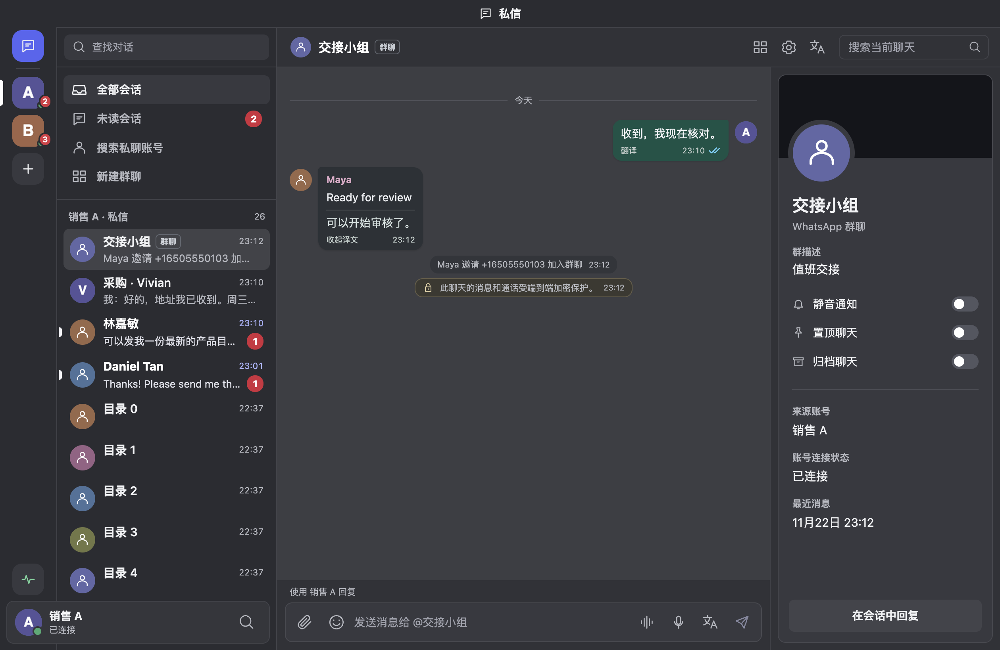
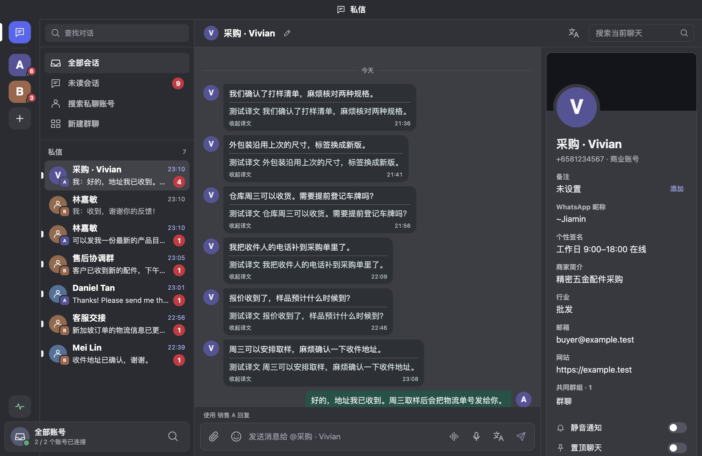
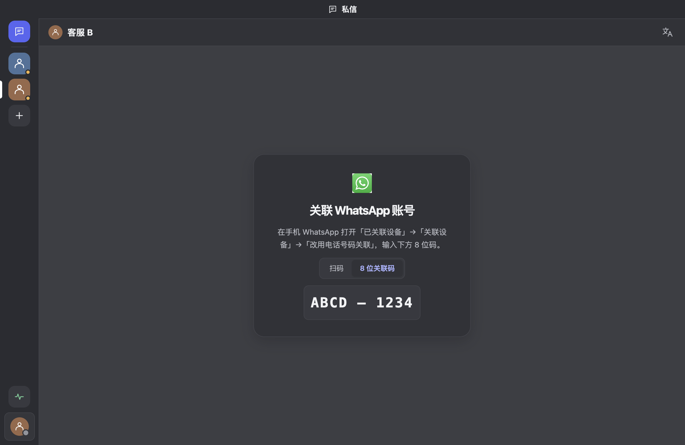

# HaiA 桌面 UI 规范

适用版本 0.9.3。使用者在一台电脑管理多个 WhatsApp 号码，在「全部账号」阅读跨账号消息，在具体对话中以来源号码回复。macOS 和 Windows 共用页面、交互和设计变量。

## 框架选型

第一版采用 Electron 45.4.1。独立持久化 Chromium 分区保存设备关联，后台 WA-JS 4.8.2 读取消息和会话事件。前台使用本地 HTML 和受限 IPC 自行渲染、接收通知和提交文本回复。统一消息列表通过「账号 UUID + 消息 ID」去重，同名联系人由来源账号与会话 ID 区分。

| 选择依据 | Electron | Tauri 2 |
| --- | --- | --- |
| 后台网页适配 | 随应用发布指定 Chromium，两个平台共享网页运行时版本 | Mac 使用系统 WKWebView，Windows 使用 WebView2，同一接口需要分端验证 |
| 多账号持久化 | 每个账号绑定一个 persist 分区，模拟账号已通过独立进程重启测试 | 可选独立数据存储，Mac 的有名 WKWebView 存储标识需要 macOS 14 及以上 |
| 安装与运行成本 | 安装包包含 Chromium，每个活跃账号运行后台页面 | 安装包通常更小。使用同样的后台网页架构时，账号仍会消耗 WebView 资源 |
| 后续复评条件 | 当前扫码个人号方案优先保障兼容性 | 改为服务器通过官方 Cloud API 接收 webhook，或有明确包体积要求时，按同等账号数复测 |

没有进行两个框架的同负载内存测试。WA-JS 属于非官方接口，网页版升级可能需要更新适配。程序退出后实时接收暂停。官方 Business Platform 属于另一种账号接入方式。

依据见 [Electron session](https://www.electronjs.org/docs/latest/api/session)、[Tauri WebView](https://v2.tauri.app/reference/webview-versions/)、[Tauri 平台配置](https://v2.tauri.app/reference/config/) 和 [WA-JS 文档](https://wppconnect.io/wa-js/)。

## Discord 私信布局

视觉基准为用户提供的 Discord 私信页截图。界面固定使用炭灰深色主题，采用 Discord 的账号图标栏、私信列表、消息时间线和联系人资料栏。系统窗口按钮保留原生位置。

| 区域 | 样式与交互 |
| --- | --- |
| 顶栏 | 高 34 px，居中显示「私信」，整栏支持拖动窗口 |
| 账号栏 | 常规宽 72 px，窄窗 62 px。主页按钮进入全部账号，账号图标切换消息范围，白色侧标指示选中项，红色角标显示未读。右键账号头像查看账号资料、重新连接或移除该账号，键盘可用 Shift + F10。加号添加账号 |
| 私信列表 | 宽 220–300 px。顶部搜索会话，支持全部与未读筛选。每行显示头像、联系人和最新消息，共两行。「全部账号」下有多个账号时，头像右下角叠加 16 px 的来源账号角标，悬停显示账号名称；进入单个账号后不再标注来源。头像 32 px，账号栏图标 40 px。未读会话以白色侧标、粗体名称和红色数字强调。底部显示所选账号名称、网页端返回的登录手机号及连接状态 |
| 聊天区 | 50 px 标题栏显示联系人与聊天内搜索，点击聊天标题查看会话资料。收到的消息左对齐，发出的消息右对齐，气泡显示头像、正文和右下角时间，按日分隔。群消息在正文上方显示成员名称。尚未取得正文的历史记录只在会话顶部汇总。同步到正文后，消息按原时间补回。输入区写明回复账号 |
| 联系人资料 | 默认收起，宽窗记住手动选择，窄于 1080 px 时可按需展开，可手动打开。展示当前联系人或群名、来源账号、账号连接状态和最近消息时间 |
| 账号关联 | 使用相同深色窗口框架。扫码和手机号关联共用面板，二维码保留白底留边，关联码分两组显示 |

导航背景为 #2B2C31，标题和资料栏为 #313238，消息区为 #3D3E44。选中行为 #43444B，主操作使用 #5865F2，正文为 #F2F3F5。账号、联系人、群和消息发送者头像从所属账号的 WhatsApp 会话读取。没有可见图片时显示通用人物图标。消息正文 14 px，气泡时间 10 px。窄窗保留账号和会话列表，联系人资料按需覆盖聊天区。

「搜索私聊账号」按姓名或手机号查询当前范围内的私聊和已保存联系人，支持带空格、括号和短横线的号码。在「全部账号」下分别显示来源账号。

## 聊天与翻译

- 群聊标识出现在会话列表和聊天标题。群动态居中显示事件和时间，成员发言使用对应头像和名称。端到端加密事件使用带锁图标的居中提示，可悬停查看 WhatsApp 返回的类型和子类型。自己发出的气泡靠右，颜色为 #145347。
- 发出的消息使用 WhatsApp 回执。时钟表示等待发送，单勾表示已发送，灰色双勾表示已送达，蓝色双勾表示已读或已播放。缺少回执时只显示时间。
- 消息下方的「翻译」显示双语内容。翻译设置支持选择来信和草稿语言，默认选择免密钥的 Google 免费接口，MyMemory 与支持对应语言的 Apertium 提供备选。自有密钥模式支持 DeepL、Microsoft Translator、Google Cloud Translation 和彩云小译。自动翻译按需开启。
- 输入框左侧选择表情。右侧翻译草稿，确认「使用译文」后回到编辑框，发送由用户单独操作。

## 媒体与消息操作

- 图片和贴纸在气泡内显示，进入可视范围后才下载原图，点击放大并可保存到电脑。语音、音频和视频点击后加载播放。文件显示名称和大小，点击保存。一次性消息只提示在手机上查看。位置、联系人名片和投票以文字摘要显示。
- 输入框左侧的回形针选择附件，也可以粘贴图片或把文件拖到聊天区。单个文件不超过 50 MB，一次最多 10 个，输入的文字作为第一个附件的说明。
- 鼠标移到消息上显示表情回应、回复和更多操作，右键消息打开同一菜单。更多操作包含复制文字、保存文件、编辑（自己发出的文字消息，发送后约 15 分钟内）、撤回和为我删除，后两项需要确认。
- 引用回复在气泡顶部显示原消息的发送者和摘要，点击跳到已加载的原消息。表情回应显示在气泡底部，点击可跟随或取消。已编辑、已转发和已撤回的消息有对应标记。
- 对方正在输入、正在录音或在线时，聊天标题右侧显示状态。自己输入时向对方发送「正在输入」。

## 备注与联系人资料

- 备注是保存在该 WhatsApp 账号里的联系人名称，不同步到手机通讯录。设置后，会话列表和聊天标题显示备注，标题旁以小字显示手机号。
- 聊天标题右侧的铅笔按钮和资料栏「备注」一行都可以打开编辑框，留空保存即清除备注。
- 资料栏内容与 WhatsApp「联系人信息」对应：手机号、备注、WhatsApp 昵称、认证名称、个性签名、商家简介与联系方式、共同群组。群聊显示成员数、群描述和创建时间。
- 静音通知、置顶聊天、归档聊天和屏蔽联系人以开关呈现，直接写回 WhatsApp。屏蔽前需要确认。

## 账号状态、转发、语音与建群

- 账号栏底部的状态按钮打开「账号状态」弹窗，按异常、待关联或连接中、正常分组列出全部账号。有异常账号时按钮变为橙色并显示数量。
- 曾经关联成功的号码回到待关联状态，即视为异常退出：记录时间和 WhatsApp 给出的退出原因，重启后仍保留，直到重新关联成功。退出时弹出应用内提示和系统通知。异常账号可直接「重新关联」，连接失败的账号可「重新连接」。
- 选中尚未关联的账号时收起会话列表栏，只保留账号栏和关联面板。
- 消息菜单的「转发」打开会话选择框，在同一账号的会话中搜索并转发。
- 输入区的麦克风录制语音消息，最长 5 分钟，可取消或发送。
- 输入区的声波按钮是语音输入：最长约 1 分钟，结束后先转成文字，再翻译成设定语言并填入输入框，默认英语，可选不翻译。聆听条上的齿轮和右键声波按钮都能打开语言设置。识别依次尝试 Hugging Face Whisper large-v3、OVHcloud Whisper、Hugging Face OpenAI Whisper，均免密钥，失败的服务暂停 30 秒至 2 分钟后再试。翻译失败时填入原话。
- 筛选区的「新建群聊」选择账号、填写群名称和成员手机号后创建群并打开，未能加入的号码会提示。

## 通用控件与群组操作

输入框、下拉选项、开关、按钮和确认弹窗采用统一的深色背景、边框与键盘焦点样式。弹层使用 140–160 ms 的淡入淡出和轻微缩放，新消息使用 180 ms 的淡入上移。开启系统减少动态效果时停用这些动画。

群聊标题右侧的网格按钮打开来源账号的群组列表，齿轮打开群设置。列表支持按名称搜索并切换群聊。群设置可查看成员、管理员、群名称与群描述，字段的编辑权限从 WhatsApp 群资料读取。

## 实际窗口

下图使用本地模拟账号拍摄，可对照联系人资料展开和收起后的阅读空间。

